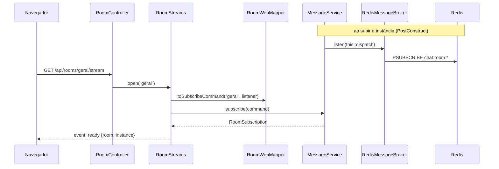
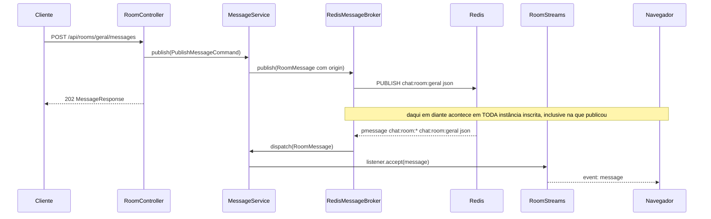

# Diagramas de sequência

<!-- externos: Redis, Navegador, Cliente -->

## 1. Assinar uma sala (SSE)

Cada instância tem **uma** inscrição no Redis (`PSUBSCRIBE chat:room:*`), feita ao subir. As conexões SSE
ficam só em memória, no `MessageService`, separadas por sala.

## 2. Publicar uma mensagem e entregar em todas as instâncias

Quem publica não entrega direto aos ouvintes locais: a mensagem sempre faz a volta pelo Redis.

